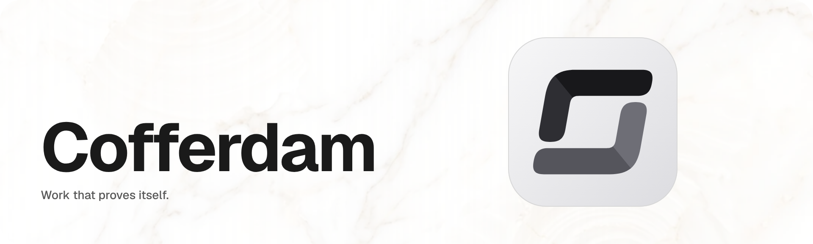

<!-- Generated from cofferdam-branding/github/profile/ — edit there, then `node scripts/sync.mjs --only=github --write`. -->

<picture>
  <source media="(prefers-color-scheme: dark)" srcset="./assets/banner-dark.png">
  <source media="(prefers-color-scheme: light)" srcset="./assets/banner-light.png">
  
</picture>

Cofferdam is a work-matching app. Workers find jobs, hirers post them, the money is set aside before the job starts, and every finished job is signed off by someone who was there.

**How it works**

1. **Post or find a job.** Hirers describe the work; workers see jobs that fit them.
2. **The money is locked before you accept.** Nobody starts work on a promise.
3. **Signed off by someone who was there.** When the job is done, it's signed off on site, so the work proves itself.

Verification is optional, but it unlocks more.

### Open source

| Repository | What it is | License |
|---|---|---|
| [**cofferdam-sdk**](https://github.com/cofferdamxyz/cofferdam-sdk) | Add "Sign in with Cofferdam", secure messages and document sharing to your own app. | MIT |
| [**cofferdam-api**](https://github.com/cofferdamxyz/cofferdam-api) | The public API behind the Cofferdam app. | Apache 2.0 |
| [**cofferdam-attester**](https://github.com/cofferdamxyz/cofferdam-attester) | Checks a person's verification before it's linked to their account. Never public-facing. | Apache 2.0 |
| [**base-contracts**](https://github.com/cofferdamxyz/base-contracts) | The open account contracts the app runs on. | MIT (open core) |
| [**cofferdam-branding**](https://github.com/cofferdamxyz/cofferdam-branding) | Our brand in one place: tokens, logos, motion and guidelines. The app and the site are generated from it. | All rights reserved |
| [**lockkeeper**](https://github.com/cofferdamxyz/lockkeeper) | Many coding agents, one repository: each change is checked against the others and merged one at a time. | MIT |

### Find us

[cofferdam.xyz](https://cofferdam.xyz)

 

<picture>
  <source media="(prefers-color-scheme: dark)" srcset="./assets/base-lockup-white.svg">
  <source media="(prefers-color-scheme: light)" srcset="./assets/base-lockup-black.svg">
  
</picture>

Built on Base.
